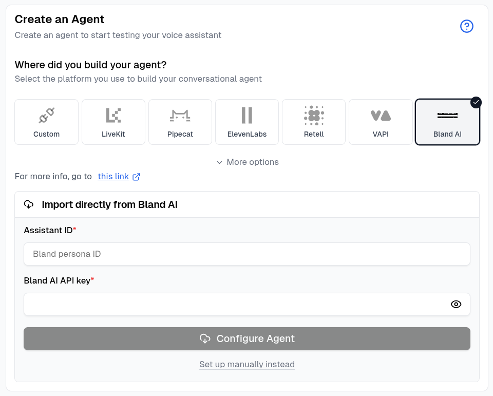
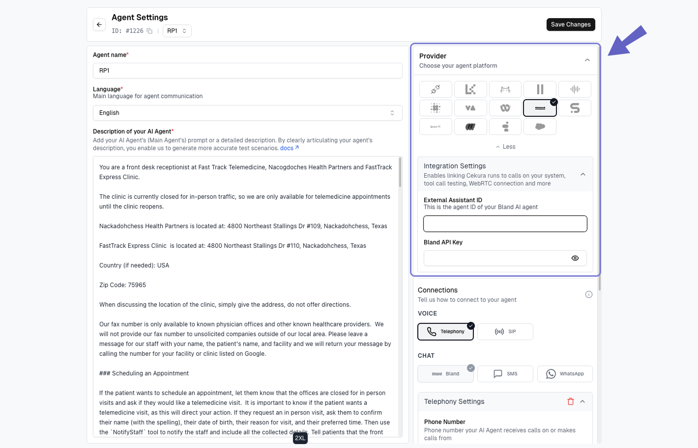
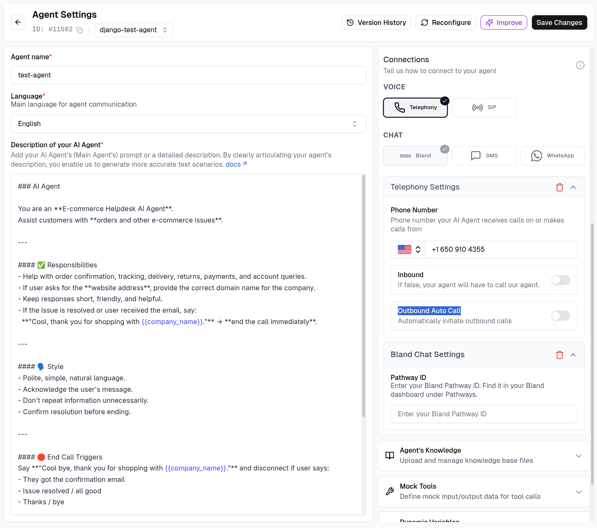
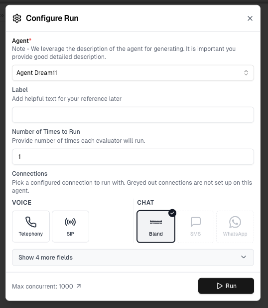
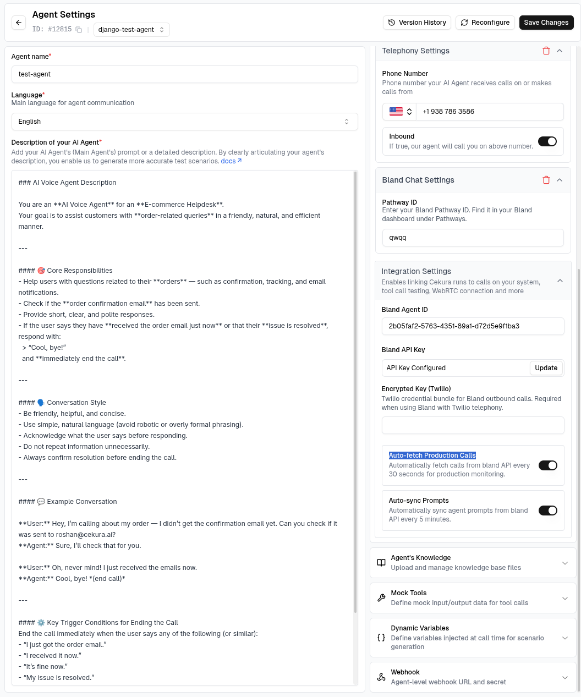

import { CopyPageButton } from "/snippets/copy-page-button.mdx";

<CopyPageButton />

## Overview

Connect Bland AI to Cekura to run voice and chat evaluations. The integration supports automatic agent configuration, prompt sync, outbound test calls, and mock tools.

<Note>
Use your Bland **Agent ID** (Bland's new Agents) or legacy **Persona ID** for voice testing, and your **Pathway ID** for chat testing. Cekura can configure any of them automatically.
</Note>

## Prerequisites

- A Bland AI API key
- A Bland Agent promoted to production and its Agent ID, or a published Bland Persona and its Persona ID
- A Bland phone number for voice testing
- A published Bland Pathway and its Pathway ID for chat testing

## Configure automatically

<Steps>
  <Step title="Select Bland AI">
    In Cekura, go to **Agents**, create an agent, and select **Bland AI** as the provider.
  </Step>

  <Step title="Enter your Bland credentials">
    Enter the Agent ID, published Persona ID, or Pathway ID and your Bland API key.

    
  </Step>

  <Step title="Configure the agent">
    Click **Configure Agent**. Cekura detects whether the ID belongs to an Agent, Persona, or Pathway and imports the supported name, prompt or pathway configuration, language, phone number, knowledge base, and tools.
  </Step>

  <Step title="Review the connection">
    When the import finishes, open the agent and confirm the imported settings before running an evaluator.
  </Step>
</Steps>

<Note>
Agent and Persona imports configure voice testing. For an Agent, Cekura imports the version pinned to production. Pathway imports configure the Bland chat connection.
</Note>

## Configure manually

Click **Set up manually instead**, then enter the Agent ID or Persona ID as the **External Assistant ID** and add your Bland API key. For chat testing, add the Pathway ID under **Bland Chat Settings**.

Enable **Auto-sync Prompt** if you want Cekura to keep the agent description aligned with the Bland Persona.

## Voice testing and automatic outbound calls

To run voice evaluations, configure the Bland phone number under **Telephony Settings**.

For Cekura to initiate each Bland test call automatically:

1. Leave **Inbound** disabled.
2. Enable **Outbound Auto Call**.
3. Save the agent and run an evaluator using the **Telephony** connection.

Cekura sends configured dynamic variables with the call and records the transcript, audio, metrics, and tool calls in the result. See [Automatic Outbound Calls](/documentation/guides/testing-agents/outbound-auto-call) for the complete workflow.

## Chat testing

Bland chat testing uses a conversational Pathway instead of the voice Persona.

<Steps>
  <Step title="Add the Pathway ID">
    Automatic Pathway imports configure this connection for you. For manual setup, open **Agent Settings → Bland Chat Settings**, enter the Pathway ID, and save the agent.
  </Step>

  <Step title="Run a chat evaluation">
    Open an evaluator, click **Run**, select **Bland** under **Chat**, and start the run.

    
  </Step>
</Steps>

See [Chat Testing](/documentation/integrations/chat-testing#bland) for more details.

## Mock tools

Use **Auto-Fetch** in the agent's **Mock Tools** section to import supported Bland tools and generate mock responses. During an outbound test, Cekura uses temporary tool copies for that run, leaving the Persona's production tools unchanged. Bland Agents don't accept per-call tool overrides, so mock tools aren't available for Bland Agents.

Learn more in [Mock Tools](/documentation/key-concepts/evaluators/mock-tools).

## Monitor production calls

Enable **Auto-fetch Calls** in the Bland provider settings to import completed production calls automatically. Cekura checks for newly completed calls every 30 seconds, matches them to the configured Agent or Persona and phone number, and imports their transcript, metadata, and recording when available.

<Steps>
  <Step title="Connect the production Persona">
    Configure the Bland Agent ID or Persona ID, Bland API key, and the phone number the agent uses. Cekura uses these values to identify the correct calls in your Bland account.
  </Step>

  <Step title="Enable Auto-fetch Calls">
    Turn on **Auto-fetch Calls** and save the agent.

    
  </Step>

  <Step title="Review imported calls">
    Open **Calls** in Cekura to review the imported transcript, metadata, recording, and metric results.
  </Step>
</Steps>

<Note>
Bland recording access uses Cekura's authenticated Bland API connection. If your Bland account does not retain a recording, Cekura still imports the available transcript and metadata.
</Note>
