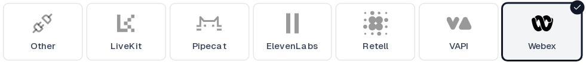
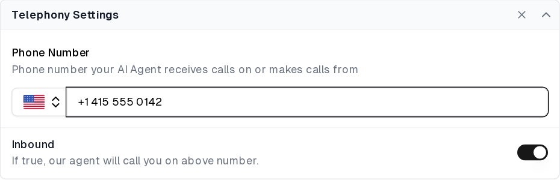
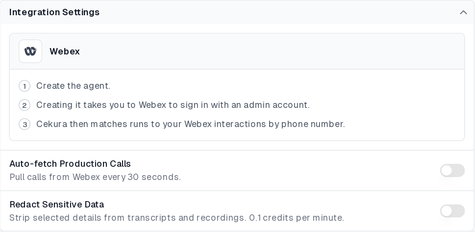
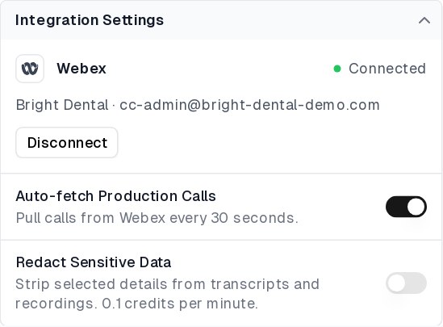
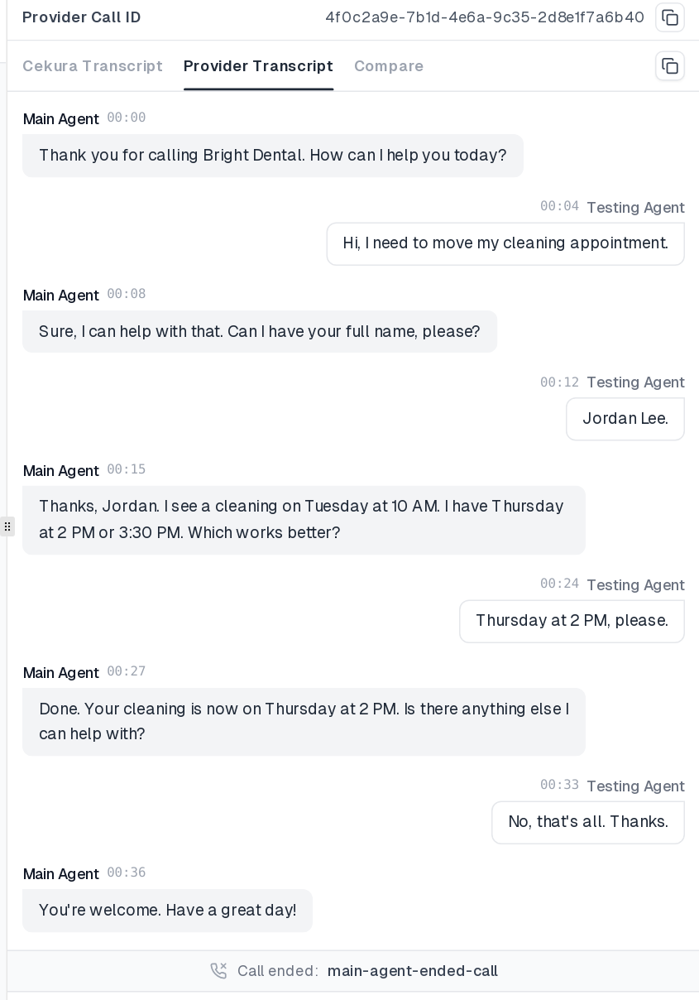

import { CopyPageButton } from "/snippets/copy-page-button.mdx";

<CopyPageButton />

## Overview

Cekura tests Webex Contact Center voice agents over the phone: it calls your agent's number and plays the scenario as the caller.

Connect Webex with one sign-in from a Contact Center administrator, and Cekura also:

- finds the Webex interaction behind each test call and shows Webex's transcript and interaction ID on the result;
- for a Webex AI Agent Studio agent, shows the tool calls the AI agent made during each test call;
- imports your production calls automatically, with **Auto-fetch Production Calls**.

<Note>
Webex agents are tested over the phone only. Chat testing is not available for Webex.
</Note>

## Prerequisites

- A Webex Contact Center voice agent reachable on a phone number.
- A Webex account with Contact Center administrator access, to connect Webex.
- For an AI Agent Studio agent's tool calls and conversation: the same account needs **Decrypt access** in AI Agent Studio. Being a Studio administrator is not enough on its own. See [Turn on Decrypt access](#turn-on-decrypt-access).
- For Webex transcripts and recordings: recording and transcription turned on in Webex Contact Center for the calls you test. Webex keeps a recording only where recording is enabled for the tenant or queue, and a transcript only where a transcription feature is enabled.

## Connect Webex in Cekura

<Steps>
  <Step title="Select Webex">
    In Cekura, go to **Agents**, create an agent, and select **Webex** as the provider.

    
  </Step>

  <Step title="Add the phone number">
    Under **Connections → Voice**, select **Telephony** and enter your agent's phone number under **Telephony Settings**. Leave **Inbound** on so Cekura calls your number.

    
  </Step>

  <Step title="Create the agent and sign in to Webex">
    **Integration Settings** shows the Webex steps. Click **Next**, enter the agent's name, language and description, and click **Create**. Cekura checks the phone connection and offers a test call, which you can skip.

    Cekura then takes you to Webex. Sign in with your Contact Center administrator account and accept the request. Webex sends you back to the agent in Cekura. Cekura finds your Webex organization and datacenter from the sign-in, so there is nothing to type.

    
  </Step>

  <Step title="Check the connection">
    On the agent's page, **Integration Settings** shows **Connected** with your Webex organization and the account that connected it. If the sign-in didn't start, click **Connect Webex** there.

    If that account has no Decrypt access in AI Agent Studio, the card also shows a warning naming the account. See [Turn on Decrypt access](#turn-on-decrypt-access).

    
  </Step>
</Steps>

Cekura asks Webex for read-only access: the signed-in user's identity, your organization, and your Contact Center configuration, interactions, recordings and transcripts. The permissions requested are `spark:people_read`, `spark:organizations_read` and `cjp:config_read`. With the same sign-in, Cekura reads your AI Agent Studio call sessions for the AI agent's tool calls and conversation.

### Connection status

| Status | Meaning |
| --- | --- |
| **Connected** | Cekura can read your Webex Contact Center data. |
| **Expiring soon** | The sign-in expires within 7 days. Click **Reconnect Webex**. |
| **Expired** | The sign-in has expired. Click **Reconnect Webex**. |
| **Disconnected** | Webex refused to renew access; the card shows Webex's message. Click **Reconnect Webex**. |

Click **Disconnect** to remove Cekura's access to your Webex organization.

### Turn on Decrypt access

AI Agent Studio shows call sessions only to users with **Decrypt access**, including its administrators. Without it, Cekura can't read the AI agent's tool calls or conversation, and the Webex card in Cekura shows a warning naming the account that connected Webex.

A Webex full administrator can turn it on:

<Steps>
  <Step title="Open the teammates list">
    In AI Agent Studio, click the user icon, then **Enterprise Profile** → **Teammates**.
  </Step>

  <Step title="Turn on Decrypt access">
    Click **Modify** next to the account that connected Webex, turn on **Decrypt access**, and click **Modify**.
  </Step>
</Steps>

You don't need to reconnect Webex. The warning clears when you come back to the agent's page in Cekura.

## Run a test

Open an evaluator, click **Run**, and start the run using the **Telephony** connection. Cekura calls your agent's number and plays the scenario as the caller.

When Webex is connected, Cekura looks up the Webex interaction after the call ends. It searches for a call between its own number and your agent's number that started within a minute of the test call, then compares the duration and conversation, so parallel test calls are each paired with the right interaction. Webex saves the transcript shortly after the call wraps up, so this can take a couple of minutes.

The result then shows:

- **Provider Transcript**: the conversation as Webex transcribed it. Your Webex agent is labeled **Main Agent** and Cekura's caller **Testing Agent**. **Cekura Transcript** keeps Cekura's own transcript, and **Compare** shows them side by side.
- **Provider Call ID**: the Webex interaction ID, so you can find the call in Webex.
- **Tool calls**, for an AI Agent Studio agent: each action the AI agent ran, with its name and inputs, in place among the conversation turns. Webex keeps no output for most actions that succeed, so a result line usually appears only when an action failed.



### AI agent calls without a Contact Center transcript

Webex Contact Center often keeps no transcript of a call handled by an AI agent. Cekura then pairs the call by its start time and length. When several test calls fit, Cekura reads the AI agent's conversation from AI Agent Studio to tell them apart, and shows that conversation as the **Provider Transcript**.

<Note>
AI Agent Studio protects each conversation, so reading one unlocks it. Studio records each unlock in its audit log as **View interaction transcript**, under the account that connected Webex. Cekura does this only for its own test calls, and only when it needs the words to pair a call.
</Note>

<Tip>
Test calls that play the same scenario from the same Cekura number say nearly the same words. When you run many of them at once, turn on **Randomize** in the run settings so each call comes from a different phone number and is paired by its number.
</Tip>

<Note>
If Webex is not connected, or neither Contact Center nor AI Agent Studio supplied the conversation, the result shows Cekura's own transcript, with the AI agent's tool calls when Cekura found them.
</Note>

## Monitor production calls

Turn on **Auto-fetch Production Calls** under **Integration Settings** once Webex is connected, and save the agent. Every 30 seconds, Cekura imports ended Webex Contact Center phone calls to or from the number under **Telephony Settings**, and runs your metrics on them.

- Each imported call includes Webex's transcript and recording when Webex has them, plus the queue, entry point and Webex agent that handled it.
- Calls between your number and Cekura's test numbers are skipped, so test calls are not imported again.
- A call appears a few minutes after it ends.

<Note>
If Webex has no recording or transcript for a call, Cekura still imports the call with its duration and details.
</Note>

## Troubleshooting

- **Webex did not authorize the connection**: sign in with an account that has Contact Center administrator access and accept the request, then click **Connect Webex** to try again.
- **No Webex Contact Center datacenter recognises this organization**: the account that signed in is not a Contact Center administrator, or the organization has no Contact Center. Sign in with a Contact Center administrator account.
- **Webex rejected the authorization code**: the sign-in expired or was already used. Click **Connect Webex** again.
- **This Webex organization is already connected to a different Cekura organization**: a Webex organization can be connected to one Cekura organization only. Disconnect it there, or contact Cekura support.
- **No Webex transcript on a result**: check that Webex shows **Connected**, that the number under **Telephony Settings** is the one Cekura called, and that Webex records and transcribes calls on that number's queue. The transcript can take a couple of minutes after the call.
- **Production calls are not imported**: check that **Auto-fetch Production Calls** is on, Webex shows **Connected**, and the number under **Telephony Settings** matches your agent's number in Webex.
- **"… has no Decrypt access in AI Agent Studio", or no tool calls on a result**: the account that connected Webex can't read AI Agent Studio's call sessions. [Turn on Decrypt access](#turn-on-decrypt-access) for it, or reconnect Webex with an account that has it.
- **Tool calls show inputs but no result**: Webex keeps no output for most actions that succeed, so a result usually appears only when an action fails.
- **Parallel test calls are not paired**: if the calls came from one Cekura number and played the same scenario, their words can be too alike to tell apart. Turn on **Randomize** in the run settings and run them again.

## Configure through the API

Create the agent through the [API](/api-reference/test_framework/create-agent) with the provider set to `cisco` and the agent's phone number:

```json
{
  "name": "Support line",
  "description": "Answers customer calls.",
  "project": 123,
  "telephony": {
    "phone_number": "+15551234567",
    "inbound": true
  },
  "provider": {
    "type": "cisco"
  }
}
```

Connecting Webex needs a browser sign-in, so open the agent in Cekura and click **Connect Webex**. The agent's `provider.credentials.connection` field then reports the connection, with `status`, `org_name`, `connected_by`, `refresh_token_expires_at` and `studio_decrypt_access` (`true` or `false` for whether that account has Decrypt access in AI Agent Studio, `null` when unknown). Turn on production-call import with `provider.auto_import_calls: true` once Webex is connected.
